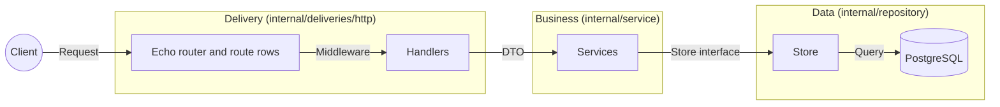

# Go Echo Boilerplate


[](LICENSE)

A clean-architecture boilerplate for REST APIs in Go with the Echo framework. Use it as the start of any kind of service.

## Features

- **Web framework**: [Echo v4](https://echo.labstack.com/).
- **Clean Architecture**: HTTP handlers call services, and services call a repository through small interfaces that each service declares.
- **Database**: PostgreSQL with [GORM](https://gorm.io/), and [Goose](https://github.com/pressly/goose) for migrations.
- **Authentication**: an API key on every `/api` route, and JWT access and refresh tokens with revocation on logout.
- **Configuration**: one YAML file per environment, loaded with [Viper](https://github.com/spf13/viper) and checked at startup.
- **Logging**: one wide event per request with [wlog](https://github.com/jeremygprawira/wlog) on [Zap](https://github.com/uber-go/zap), with sensitive values masked.
- **Security controls**: per-route rate limits, idempotency keys, CORS, a body size limit and request timeouts.
- **Development**: hot reload with [Air](https://github.com/air-verse/air), and a [Makefile](Makefile) for every task.
- **Containers**: a Dockerfile in `builds/` and a Docker Compose file for the app and Postgres.
- **API docs**: Swagger docs generated by [swag](https://github.com/swaggo/swag). `make docs-check` fails on stale docs.
- **Tests**: unit tests with sqlmock, an integration suite on real Postgres, and coverage reports.

## Architecture



Dependencies point inward. A service never imports the repository, gorm or echo, and a lint check enforces it. [AGENTS.md](AGENTS.md) describes each layer, the steps to add a feature, and the rules with the checks that enforce them. Read it before you change the code, whether you are a person or a coding agent.

## Project structure

```
.
├── cmd/http/           # main.go: loads the config, builds the app, runs it until a signal
├── config/             # config.local.example.yaml; copy it per environment
├── docs/               # Generated Swagger docs, and guides in docs/markdowns
├── internal/
│   ├── config/         # Loading and checking the configuration
│   ├── core/           # Composition root: builds the store, the services and the server
│   ├── deliveries/     # HTTP server, route rows, handlers and middleware
│   ├── integration/    # Integration suite that runs on real Postgres
│   ├── models/         # Entities, DTOs and the store errors
│   ├── pkg/            # Shared helpers: JWT, logger, validator, generator and more
│   ├── repository/     # The Store type and its PostgreSQL queries
│   └── service/        # Business logic, one service per feature
├── lint/               # ruleguard rules that golangci-lint runs
├── migration/          # Goose SQL migrations
├── scripts/            # Repo checks and the integration test runner
├── tools/              # Pinned versions of golangci-lint, gosec, deadcode and swag
└── docker-compose.yml  # The app and Postgres
```

## Getting started

### Prerequisites

- Go 1.26 or newer. The `go` command downloads the exact toolchain that `go.mod` names.
- Docker with Docker Compose.
- Make and `jq` (`make run` pipes the log through `jq`).

### Run it locally

1. Clone the repository:

    ```bash
    git clone https://github.com/jeremygprawira/go-echo-boilerplate.git
    cd go-echo-boilerplate
    ```

2. Install `air` (hot reload) and `goose` (migrations):

    ```bash
    make install-tools
    ```

    golangci-lint, gosec, deadcode and swag need no install. They are pinned in `tools/go.mod` and run through `go tool -modfile=tools/go.mod`.

3. Create `.env` for the Compose Postgres and the migrations:

    ```bash
    cp .env.example .env
    ```

    Fill in each value, for example `DB_USER=app`, `DB_PASSWORD=app`, `DB_NAME=app`, `DB_SSL_MODE=disable`, `DB_HOST=localhost` and `DB_PORT=5888`. Compose publishes Postgres on port 5888 of your machine.

4. Create the config file for the `local` environment:

    ```bash
    cp config/config.local.example.yaml config/config.local.yaml
    ```

    The example sets `application.name` to `go-echo-boilerplate` and `application.port` to `8080`. Startup fails on an empty name or a port outside 1 to 65535. Set the `postgresql` block with the same values as `.env`. Replace the three `replace-with-` secrets with values from `openssl rand -base64 48`. Startup fails while a placeholder is left. Config files other than the example are gitignored, so your secrets stay local.

5. Start Postgres and apply the migrations:

    ```bash
    docker compose up -d postgres
    make migrate-up
    ```

    If `make migrate-up` fails with a connection error, Postgres is still starting. Wait a few seconds and run it again.

6. Start the server, with hot reload or without:

    ```bash
    make dev ENV=local    # regenerates the Swagger docs, then runs air
    make run ENV=local    # runs once
    ```

7. Check that it answers:

    ```bash
    curl localhost:8080/health
    ```

    Every route under `/api` needs the `X-API-Key` header with your `authorization.api_key`. Outside production, Swagger UI is at `http://localhost:8080/swagger/index.html`.

## Testing and checks

```bash
make test               # unit tests with the race detector
make test-coverage      # coverage report in coverage/coverage.html
make test-integration   # integration suite on a throwaway Postgres container (needs Docker)
make ci                 # every check: tidy modules, build, tests, lint, gosec, repo rules, dead code, Swagger docs
```

`make ci` is the gate. Run it before you push. It needs no Docker and no GitHub Actions. To run it on every push, run `make hooks` once. To skip it for one push, use `git push --no-verify`. To turn it off, run `make unhooks`.

The GitHub Actions workflow is optional. It runs the same `make ci` and the integration suite against a Postgres service. On a pull request, it also checks that the PR targets `master` or a branch with an open PR. Run that last check locally with `make pr-base PR=<number>`. It needs the `gh` CLI, logged in.

## Docker

`make docker-up` builds the app image and starts the app and Postgres. The app container reads `config/config.dev.yaml`, so create it from the example first. Inside Compose, Postgres is at host `pgdb`, port `5432`. The app answers on `http://localhost:8090`.

```bash
make docker-up      # build and start the app and Postgres
make docker-logs    # follow the logs
make docker-down    # stop the containers
```

After a Go version bump, rebuild with `docker compose build --pull`. The golang image sets `GOTOOLCHAIN=local`, so a cached `golang:1.26-alpine` older than the `go` directive in `go.mod` fails the build.

## Authentication flow

The service uses two tokens:

1. **Access token**: short-lived (15 minutes in the example config). Send it as `Authorization: Bearer <token>` to the routes that need a caller, such as `GET /api/v1/users/me`.
2. **Refresh token**: long-lived (7 days in the example config). Send it to `POST /api/v1/users/tokens/refresh` to get a new pair. Logout revokes both tokens.

The [JWT usage guide](docs/markdowns/JWT_USAGE.md) has the details. The [logging guide](docs/markdowns/LOGGING.md) explains the wide event and the masking of credentials. `make help` lists every make command.

## Contributing

1. Fork the project and create a branch.
2. Read [AGENTS.md](AGENTS.md). It holds the architecture, the owner's rules and the rule table.
3. Run `make ci`. If you change the service or repository layer, also run `make test-integration`.
4. Open a pull request.
